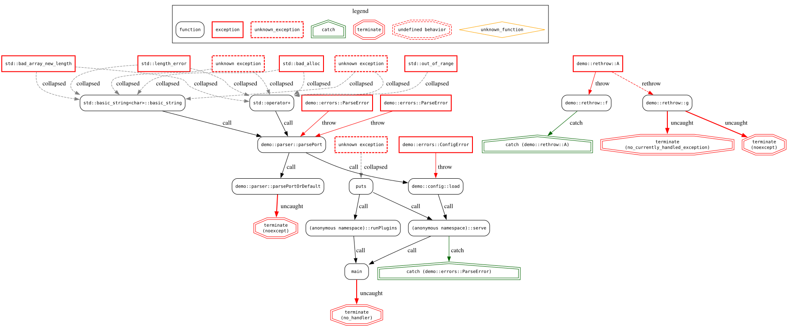

# exception-analysis

Whole-program C++ exception analysis for Bazel `cc_binary` targets, built on
clang's Scalable Static Analysis Framework (SSAF).

Given one linked executable it answers **which exceptions can be thrown, which
functions they unwind through, and where they are caught or not caught.**

See [docs/design.md](docs/design.md).

## Plan

Short term project bottom up. Given SSAF what data can we extract from build.
Assuming this project is riddled with dead ends in the design. Should consider
rewrite if worth developing further using findings from this experiment as input.

There are some questions I like answered before throwing it away.
 - Analyze targets build with GCC toolchain
 - Dynamic dependencies addition
 - Do a similar analysis in a CMake project as a CMake utility.
 - Isolate and clarify Bazel specifics from LLVM specifics.

## Use

```sh
bazel build //examples/cross_tu:app \
  --aspects=@exception_analysis//aspect:defs.bzl%exception_analysis \
  --output_groups=exa_graph
jq . bazel-bin/examples/cross_tu/app.exa_graph.json
```

As a test:

```starlark
load("@exception_analysis//aspect:defs.bzl", "exception_graph_test")

exception_graph_test(
    name = "app_exceptions_test",
    binary = ":app",
    check = "expect_graph.sh",
)
```

`check` gets the graph path.

Unwind paths through a function, or into each `terminate` and
`undefined_behavior` node:

```sh
bazel run //query:exa-query -- --graph $PWD/bazel-bin/examples/cross_tu/app.exa_graph.json \
  --unwinding demo::parser::parsePort --reachable-from-main
bazel run //query:exa-query -- --graph $PWD/bazel-bin/examples/cross_tu/app.exa_graph.json \
  --uncaught --reachable-from-main
```

## Example graph of `//examples/cross_tu:app`



## AUTOSAR C++14 exception rules

See [docs/autosar.md](docs/autosar.md).

## Toolchain

[hermetic-llvm](https://github.com/hermeticbuild/hermetic-llvm), pinned in
`MODULE.bazel`. The first build compiles clang from source.
